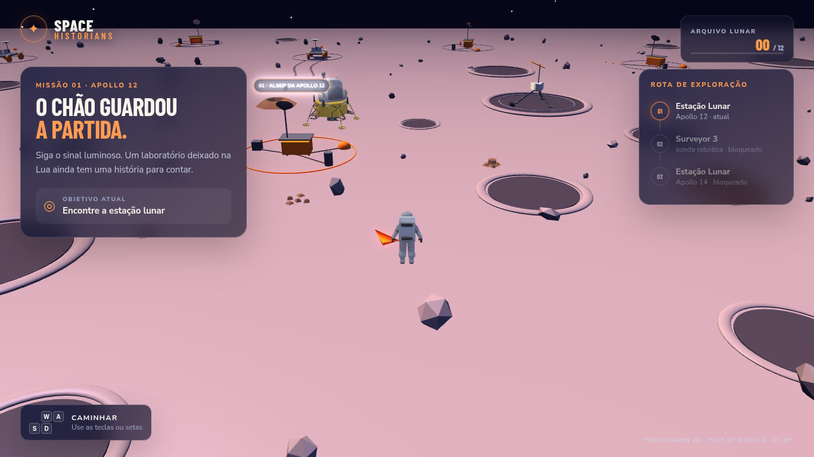
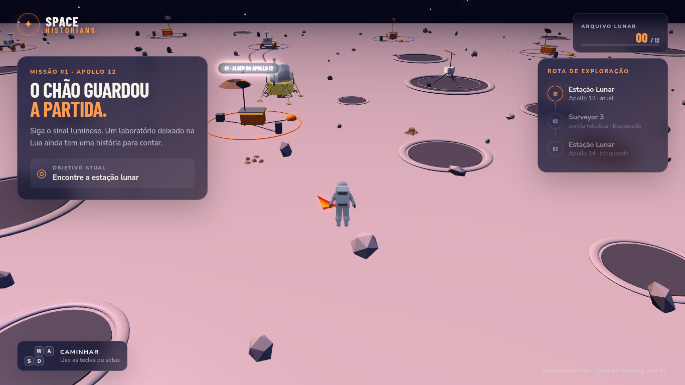
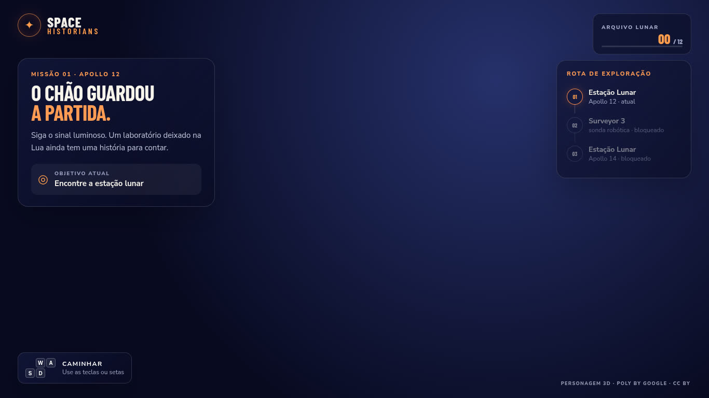

# Fallback WebGPU

Alguns navegadores (principalmente em computadores de escola) bloqueiam o WebGL. Antes, o jogo mostrava só o aviso de "3D desligado". Agora ele tenta o **WebGPU** antes de desistir.

## Como funciona

1. Se o navegador oferece WebGL, o jogo usa WebGL (caminho de sempre).
2. Sem WebGL, o jogo verifica `WebGPUEngine.IsSupportedAsync` e inicia o motor WebGPU do Babylon.js.
3. Sem nenhum dos dois, aparece o aviso, agora explicando que nem WebGL nem WebGPU estavam disponíveis.

- `?render=webgpu` no endereço força o WebGPU, para testar num navegador que tem WebGL.
- O motor em uso fica em `document.documentElement.dataset.renderer` (`webgl` ou `webgpu`).
- O início do motor WebGPU é assíncrono (`await` no nível do módulo), por isso o alvo de compilação passou a ser **ES2022** (`tsconfig.json` e `vite.config.ts`).

## Testes

Roteiro: [`testes/roteiro-webgpu.mjs`](testes/roteiro-webgpu.mjs) · resultado: [`testes/resultados-webgpu.json`](testes/resultados-webgpu.json)

| Verificação | WebGL | WebGPU |
|---|---|---|
| Motor em uso é o esperado | ✅ | ✅ |
| Modelo da NASA carregado | ✅ | ✅ |
| Sem aviso de 3D indisponível | ✅ | ✅ |
| Mapa desenhado, astronauta caminha, sem erros no console | ✅ | ✅ |

**8/8**. Também passaram `tsc` e `npm run build`.

O WebGPU foi testado com o **SwiftShader** (GPU por software do Chrome) para não depender do driver de vídeo.

| WebGL | WebGPU |
|---|---|
|  |  |

## Limitação conhecida

Na GPU da máquina de testes (Linux, WebGPU experimental no Chrome), o dispositivo WebGPU é perdido logo após iniciar (erro interno do Dawn/Vulkan ao importar memória). O Babylon.js tenta restaurar o contexto, falha ao recompilar os shaders (`Cannot read properties of undefined (reading 'shaderLanguage')`) e o mapa fica vazio:

É um problema do driver e do WebGPU no Linux, não do jogo: no mesmo navegador, com GPU por software, tudo funciona. Como o WebGPU só é usado quando o WebGL está bloqueado, o caminho normal não é afetado. Vale testar em Windows, macOS e Chromebook, onde o WebGPU é estável.
