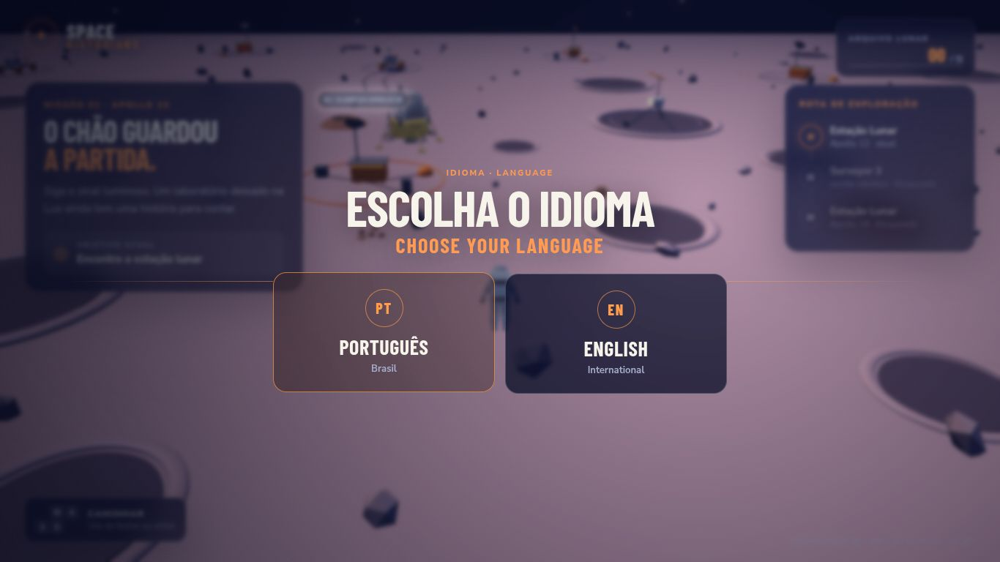
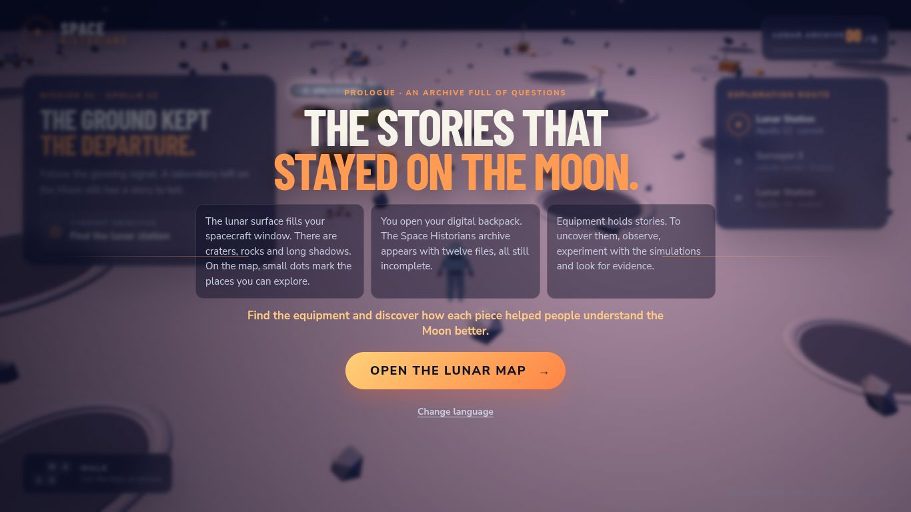
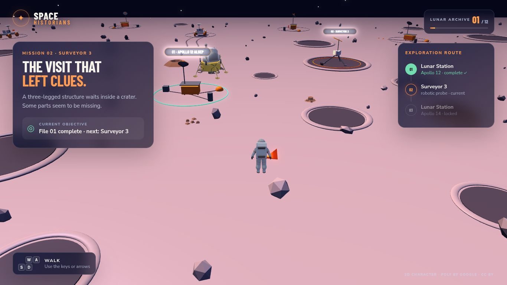
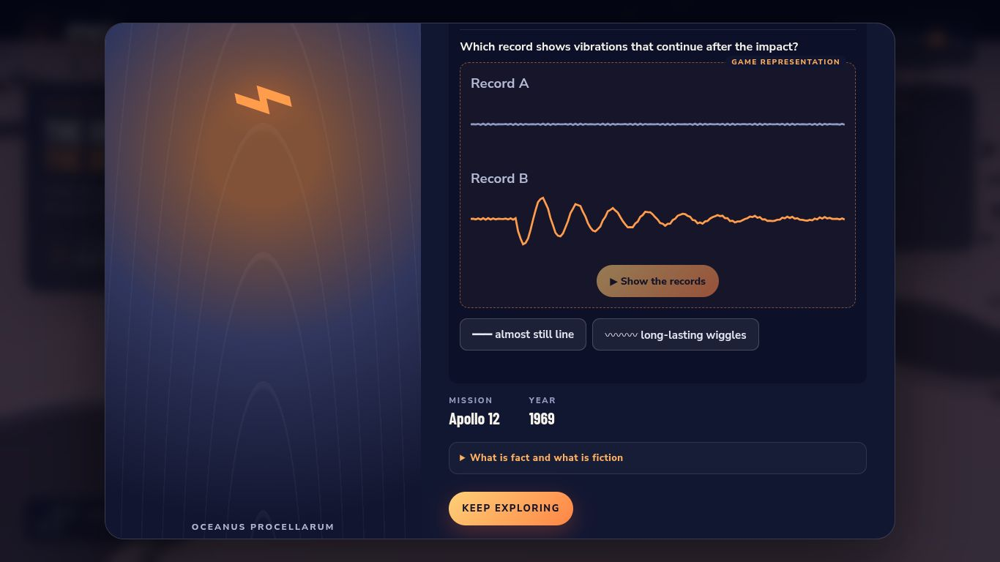
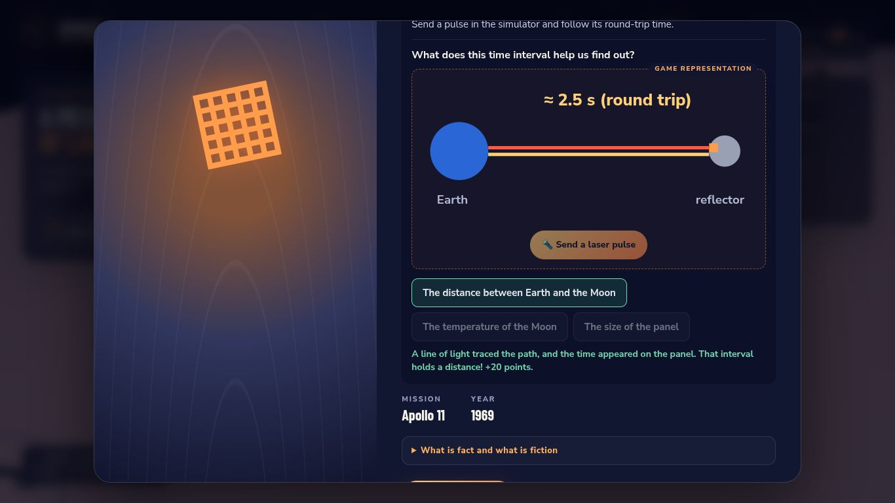
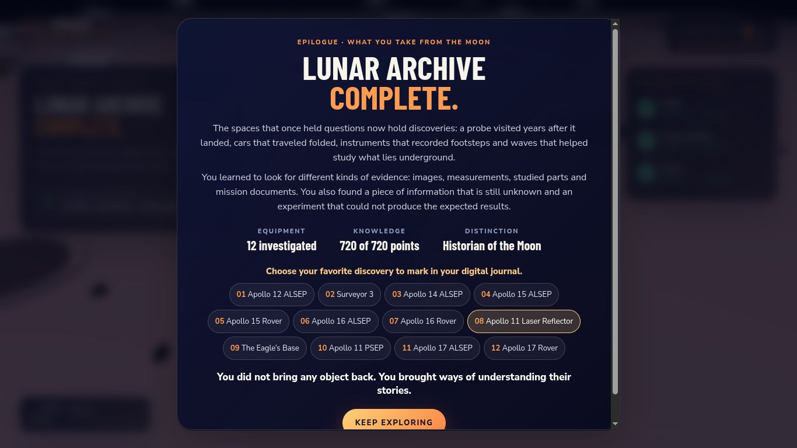

# Idiomas: português e inglês

Data: 14/11/2026 · Branch: `feat/idiomas-pt-en` (criada a partir de `feat/missoes-02-12`)

## Como funciona

1. **A primeira tela é a escolha de idioma**: Português ou English. Ela vem marcada com o último idioma usado no navegador; na primeira visita, com o idioma do navegador.
2. No prólogo, o botão **"Trocar idioma"** volta para a escolha.
3. Ao clicar em **"Abrir o mapa lunar"**, o idioma vale para a sessão inteira:
   - HUD, rota e objetivo;
   - avisos de proximidade e de bloqueio;
   - ficha completa (encontro, etapas, pistas, fato e ficção);
   - atividades;
   - simulações (rótulos, botões, unidades: 2,3 m → 2.3 m);
   - **placas 3D do mapa**;
   - epílogo;
   - título da aba e `lang` da página.
4. `?lang=pt` ou `?lang=en` no endereço pula a escolha. É útil para links de apresentação.
5. O progresso salvo é o mesmo nos dois idiomas.
6. Sem WebGL, a mensagem de orientação aparece no idioma preferido.

## Arquivos

| Arquivo | O que tem |
|---|---|
| [`src/i18n.ts`](../../src/i18n.ts) (novo) | Textos da interface nos dois idiomas; aplica os textos fixos do HTML (`data-i18n`) |
| [`src/story-data.en.ts`](../../src/story-data.en.ts) (novo) | Prólogo, 12 fichas e epílogo em inglês, **só texto** |
| [`src/story-data.ts`](../../src/story-data.ts) | `localizeStory()`: aplica a tradução sobre a estrutura (ordem, posições, respostas certas, pontos) |
| `src/main.ts`, `src/activities.ts` | Usam os textos do idioma escolhido |
| `index.html`, `src/style.css` | Tela de idioma e marcações `data-i18n` |

A tradução não tem como mudar a resposta certa: se uma lista de opções, associações ou etapas tiver tamanho diferente do original, o jogo mantém o português e avisa no console. O roteiro de testes confere que esse aviso nunca aparece.

## Testes

| Roteiro | Resultado |
|---|---|
| Idiomas ([`roteiro-idiomas.mjs`](testes/roteiro-idiomas.mjs)) | **33/33** |
| 12 missões em inglês, computador | **72/72** |
| 12 missões em inglês, tablet | **71/71** |
| 12 missões em português, computador (regressão) | **72/72** |
| Missão 01 em português, computador + tablet (regressão) | **44/44** |
| `npm run build` + versão de produção | ✓, sem erros no console |

O roteiro de idiomas também verifica que, em inglês, nenhuma letra típica do português (ç, ã, õ, acentos) aparece no HUD ou na ficha.

**Não testados:** Microsoft Edge e tablets físicos.

## Para a equipe revisar

- **A tradução para o inglês foi feita por mim** e precisa de revisão de alguém da equipe. Termos escolhidos:
  - "file" para ficha;
  - "Lunar Archive" para Arquivo Lunar;
  - "Clue:" para Pista;
  - "Historian of the Moon" para a distinção final.
- **Os nomes de lugares** seguem o uso da NASA em inglês: Ocean of Storms, Sea of Tranquility, Descartes Highlands.

## Capturas

| Escolha de idioma | Prólogo em inglês |
|---|---|
|  |  |

| HUD e placas 3D em inglês | Ficha e simulação em inglês |
|---|---|
|  |  |

| Laser em inglês | Epílogo em inglês |
|---|---|
|  |  |
