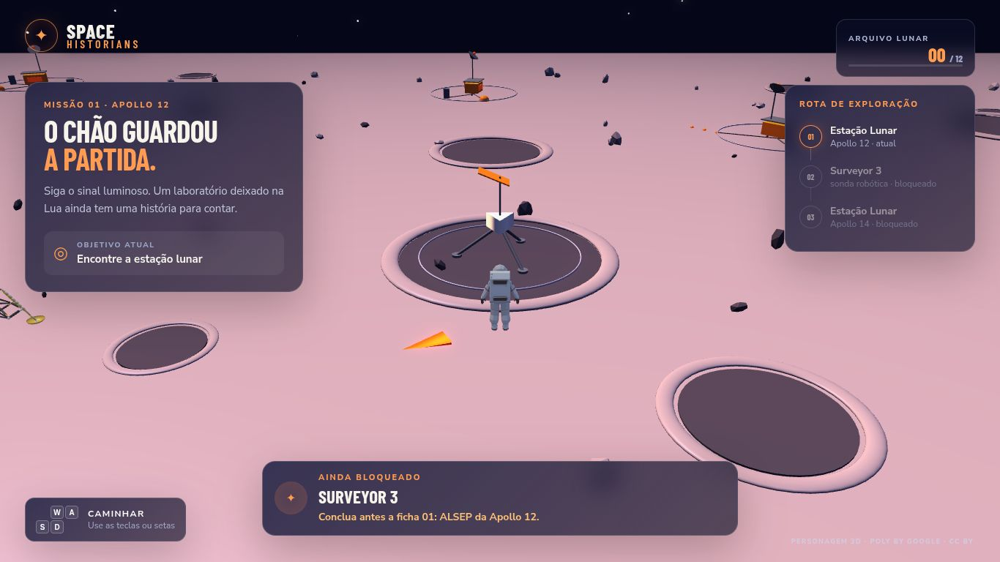
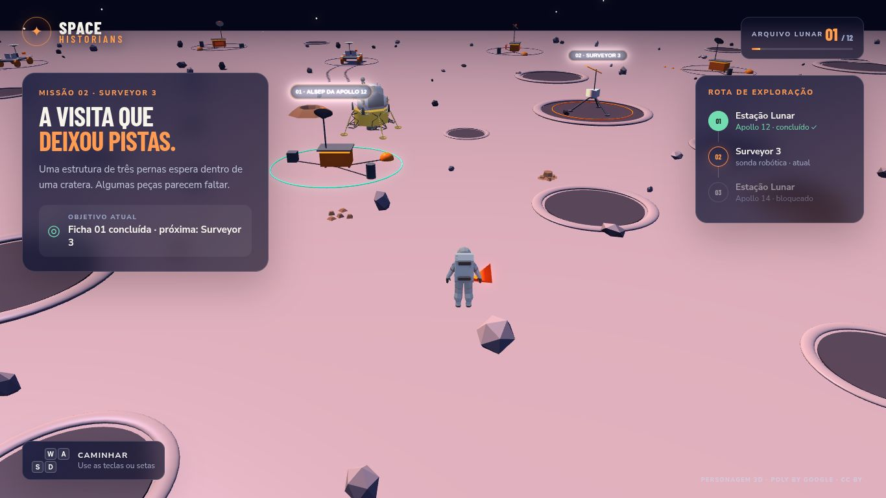
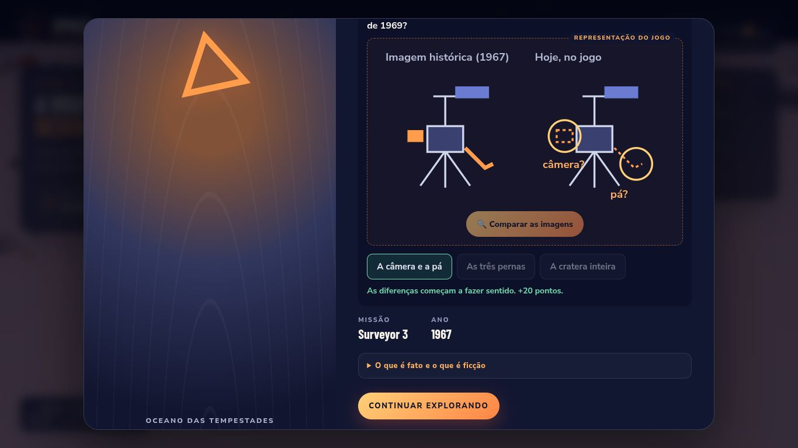
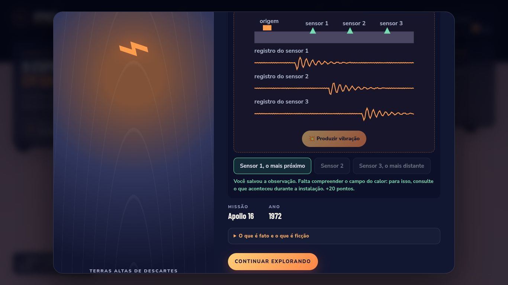
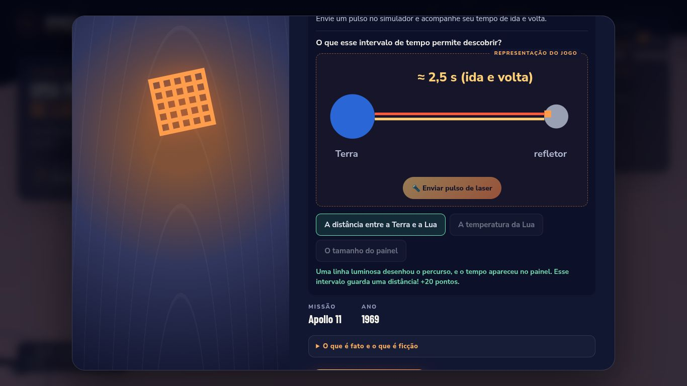
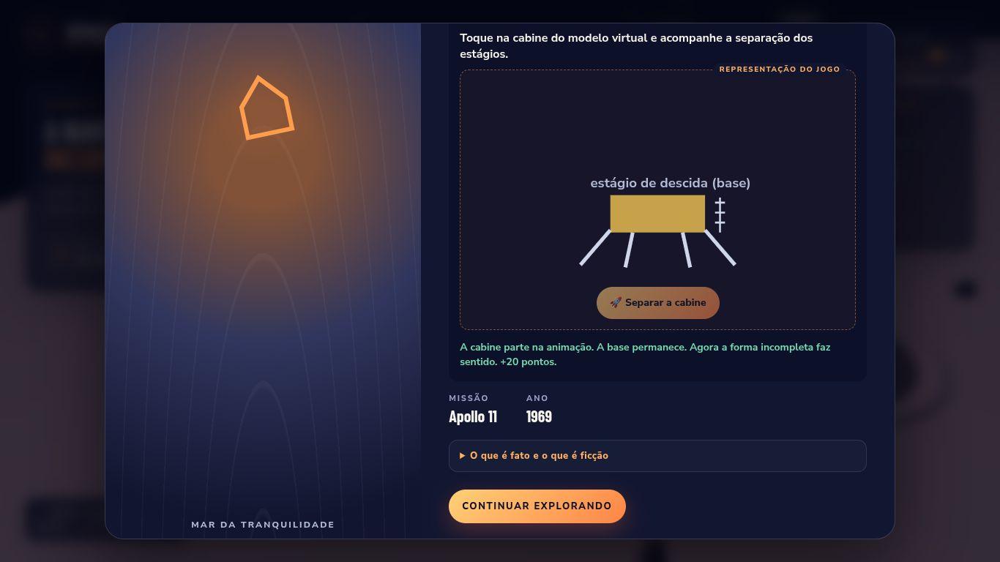
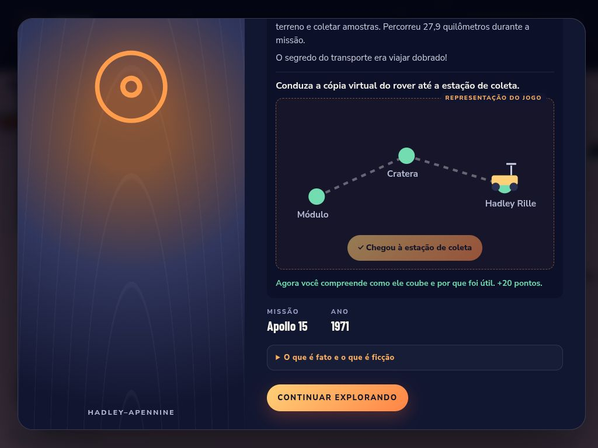
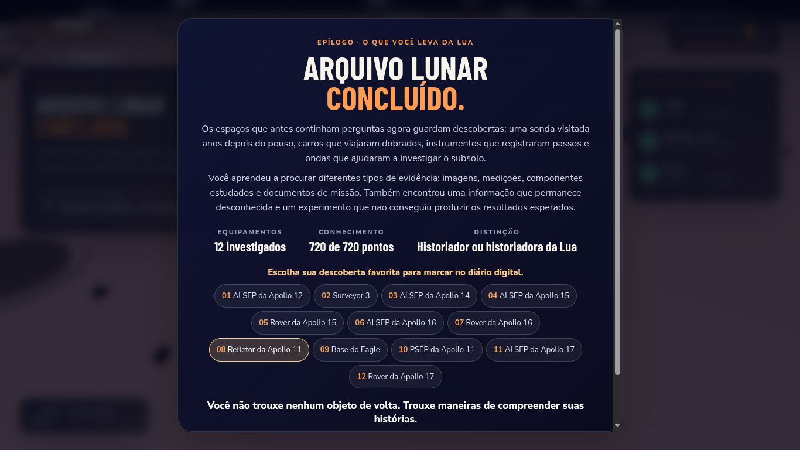

# Missões 02 a 12

Data: 14/11/2026 · Branch: `feat/missoes-02-12` (criada a partir de `fix/validacao-missao-01`)

Depois da validação da Missão 01, o modelo foi replicado para os outros 11 equipamentos, com o texto do documento de histórias.

## O que foi feito

- **Conteúdo** ([`src/story-data.ts`](../../src/story-data.ts)): as 12 fichas na ordem do roteiro. Cada uma tem encontro, três etapas (10 + 20 + 30 pontos), pista para cada atividade e o bloco "O que é fato e o que é ficção". O texto da Missão 01 não mudou.
- **Atividades** ([`src/activities.ts`](../../src/activities.ts)): escolha, associar, ordenar e simulação. As "ações do jogador" do documento viraram 8 simulações em SVG, sempre com a marca **REPRESENTAÇÃO DO JOGO**.
- **Mapa e modelos** ([`src/models.ts`](../../src/models.ts)): mapa ampliado e fora de escala, com os 12 locais. Modelos simplificados para ALSEP, Surveyor 3, rover, refletor, base do Eagle e PSEP. O modelo oficial da NASA continua como marco da Apollo 12.
- **Fluxo**:
  - as fichas são liberadas em sequência;
  - um equipamento ainda bloqueado mostra qual ficha falta concluir;
  - anéis coloridos, placas e uma seta no chão guiam até a próxima;
  - a rota de exploração permite reler fichas concluídas;
  - o epílogo mostra 720 pontos, a distinção final e a escolha da descoberta favorita.

## Atividades por ficha

| Ficha | O que é? | O que fez na Lua? | Como sabemos? |
|---|---|---|---|
| 01 ALSEP Apollo 12 | escolha | simulação: registros sísmicos + escolha | escolha |
| 02 Surveyor 3 | escolha | simulação: comparar imagens + escolha | associar |
| 03 ALSEP Apollo 14 | escolha | simulação: produzir vibração | ordenar |
| 04 ALSEP Apollo 15 | escolha | simulação: sonda de calor + escolha | escolha |
| 05 Rover Apollo 15 | escolha | simulação: desdobrar e dirigir o rover | associar |
| 06 ALSEP Apollo 16 | escolha | simulação: três sensores + escolha | escolha |
| 07 Rover Apollo 16 | escolha | simulação: dirigir até House Rock | associar |
| 08 Refletor Apollo 11 | escolha | simulação: pulso de laser + escolha | associar |
| 09 Base do Eagle | escolha | simulação: separar a cabine | associar |
| 10 PSEP Apollo 11 | escolha | simulação: dar um passo + escolha | associar |
| 11 ALSEP Apollo 17 | escolha | simulação: sinais e subsolo + escolha | escolha |
| 12 Rover Apollo 17 | escolha | simulação: percorrer o trajeto | escolha |

## Testes

Roteiro automatizado: [`testes/roteiro-12-missoes.mjs`](testes/roteiro-12-missoes.mjs). Ele percorre as 12 fichas, erra de propósito para conferir as pistas, conclui as atividades, confere o bloqueio, a seta-guia, o epílogo, a favorita e o progresso salvo.

| Ambiente | Resultado |
|---|---|
| Computador 1366×768 | **72/72** ([resultados](testes/resultados-computador.json)) |
| Tablet 1024×768, toque | **71/71** ([resultados](testes/resultados-tablet.json)) |
| Regressão da Missão 01 (computador + tablet) | **44/44** |
| `npm run build` + versão de produção | ✓, sem erros no console |

**Não testados:** Microsoft Edge e tablets físicos.

## Para a equipe revisar

- **Conteúdo novo** (não está no documento, foi criado para as atividades):
  - as opções erradas das perguntas;
  - as pistas;
  - as temperaturas ilustrativas da Apollo 15 (−21,0 °C e −18,7 °C);
  - os nomes das paradas dos rovers ("Cratera", "Cratera Shorty", "Estação de coleta").
- **O mapa é compacto.** Os locais reais ficam a centenas de quilômetros uns dos outros. O README avisa isso.
- **Os modelos dos equipamentos 02 a 12 são simplificados.** Se houver modelos oficiais da NASA para algum deles, dá para trocar sem mexer no restante.
- **Ícones da ficha** (⌁ △ ⊚ ▦ ⌂ ◫) dependem das fontes do sistema. Vale conferir no Windows e no tablet.

## Capturas

| Ficha bloqueada | Seta-guia para a próxima |
|---|---|
|  |  |

| Surveyor 3: comparar imagens | ALSEP 16: três sensores |
|---|---|
|  |  |

| Refletor: pulso de laser | Eagle: separação dos estágios |
|---|---|
|  |  |

| Tablet: rover dirigível | Epílogo |
|---|---|
|  |  |
