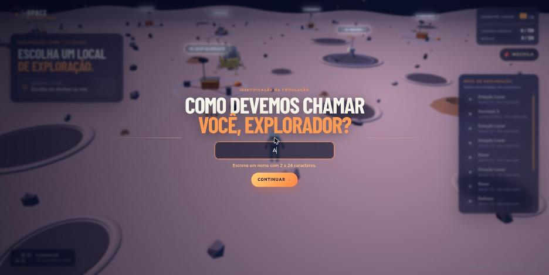
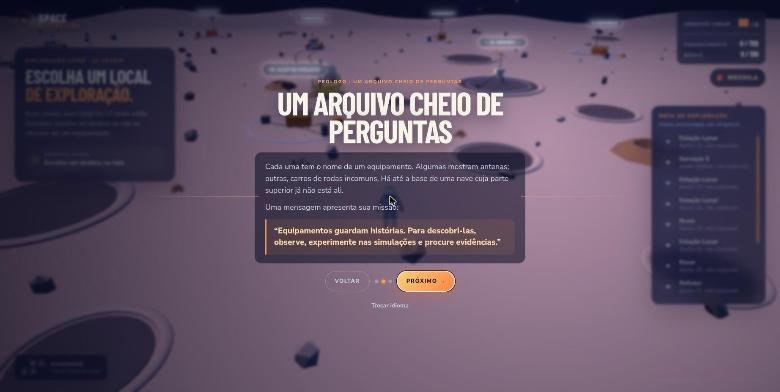
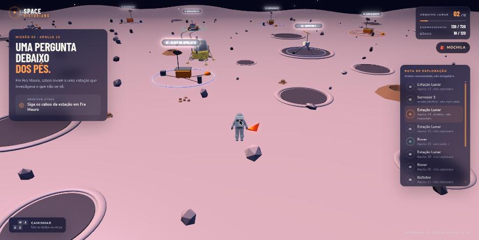
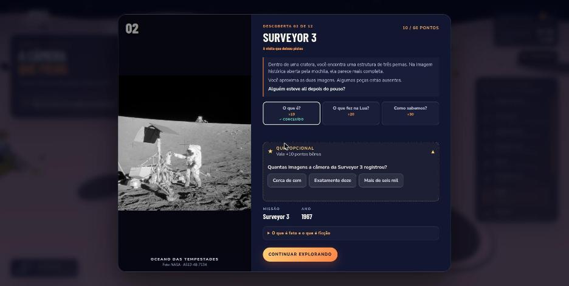
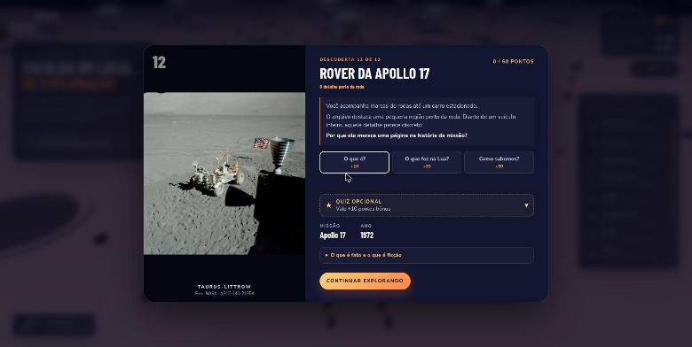
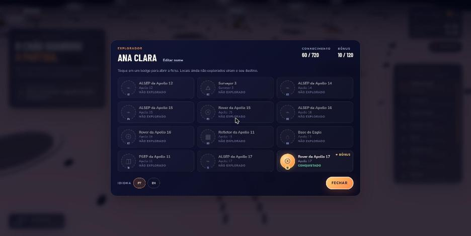
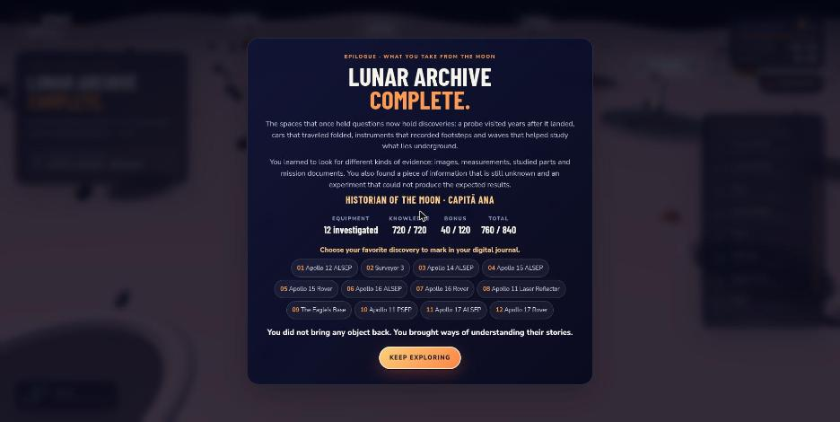

# MVP: exploração livre, fotos reais, quiz bônus e mochila

## O que mudou

- **Abertura em etapas:** idioma → nome do explorador → prólogo em páginas curtas. O nome é obrigatório, com 2 a 24 caracteres, e aparece na mochila e no epílogo. Não há mais "Pular".
- **Exploração livre:** as 12 descobertas ficam disponíveis desde o início. A rota mostra a ordem recomendada ("não obrigatória"), e um clique num item faz dele o destino da seta no chão.
- **Fotos reais da NASA** em cada ficha, com texto alternativo e crédito. Os originais ficam em `assets-src/discoveries/` (fora do build) e as cópias WebP otimizadas em `public/images/discoveries/` (2,8 MB as 12). Se uma foto não carregar, a ficha mostra o texto alternativo.
- **Pontuação separada:** cada ficha vale 60 pontos de **conhecimento** (até 720). O **quiz opcional** dá +10 de **bônus** por equipamento (até 120), para um total máximo de 840. O quiz não bloqueia nada, errar não tira pontos e o bônus conta uma vez só.
- **Mochila digital** (botão no HUD ou tecla `M`): 12 badges com quatro estados (não explorado, em andamento, conquistado e estrela de bônus). Na mochila também dá para editar o nome e trocar o idioma.
- **Epílogo** só depois das 12 descobertas, com nome, conhecimento, bônus e total.
- **Progresso salvo** numa única chave versionada (`space-historians:progress:v2`). O formato anterior (`space-historians:progresso:v1`) é migrado automaticamente e a chave antiga é apagada.
- Todos os textos novos estão em `i18n.ts` (PT e EN), inclusive o `✓ CONCLUÍDO`, que antes ficava fixo no CSS.

## Decisões

- **Astronauta:** o GLB do Poly não tem esqueleto. Seguindo o handoff, o modelo foi mantido e ganhou uma animação compatível com malha única: quique, inclinação para a frente e balanço lateral ao andar.
- **Espanhol:** o handoff deixa o espanhol para outra etapa. A tradução completa (interface e as 12 histórias) está guardada na branch local `feat/idioma-es`.
- **Foto 09 (Base do Eagle):** a imagem orbital do LRO não mostra a base com nitidez nesse recorte, então o texto alternativo descreve só o terreno do Mar da Tranquilidade.

## Capturas

| Nome obrigatório (erro com 1 letra) | Prólogo em páginas |
|---|---|
|  |  |

| HUD com conhecimento e bônus · rota livre com destino | Ficha com foto e quiz aberto |
|---|---|
|  |  |

| Ficha 12 aberta primeiro (1366×768) | Mochila com badge conquistado e bônus |
|---|---|
|  |  |

| Epílogo em inglês: 720 / 720 · 40 / 120 · 760 / 840 |
|---|
|  |

## Testes (Chrome, manual com roteiros no console)

| Cenário | Resultado |
|---|---|
| Nome com 1 caractere | bloqueia, com mensagem de erro |
| Abrir primeiro o objeto 12 | ficha abre, sem bloqueio |
| Rota: 12 itens, nenhum "bloqueado" | ok |
| Clique na rota | vira destino; a seta aponta para ele |
| Quiz errado e depois certo | erro sem perda de pontos; acerto dá +10 uma vez só |
| Recarregar a página | nome, pontos, quiz, badge, destino e idioma mantidos |
| 12 fichas com 4 quizzes | epílogo abre: 720 / 720 · 40 / 120 · 760 / 840 |
| 12 fichas com 12 quizzes | total 840 |
| `?reiniciar` | apaga tudo e volta a pedir o nome |
| Progresso no formato v1 | migrado (70 pontos, badge 01); chave antiga removida |
| 1366×768, 1024×768 e 768×1024 | sem sobreposição depois do ajuste para telas de até 780 px (cartão da missão ao lado do HUD; no celular, embaixo) |
| Console | sem erros nem avisos |

`npx tsc --noEmit` sem erros · `npm run build` ok (aviso de bundle grande, que já existia antes).
