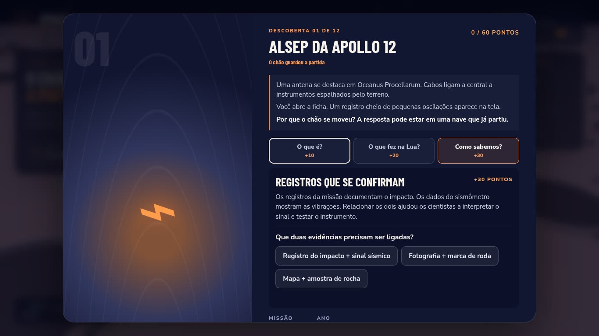
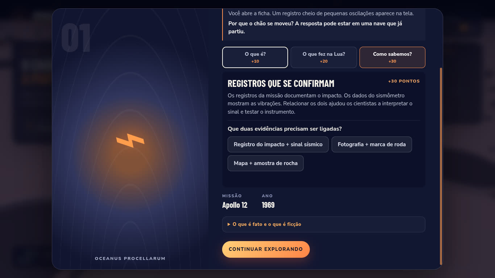
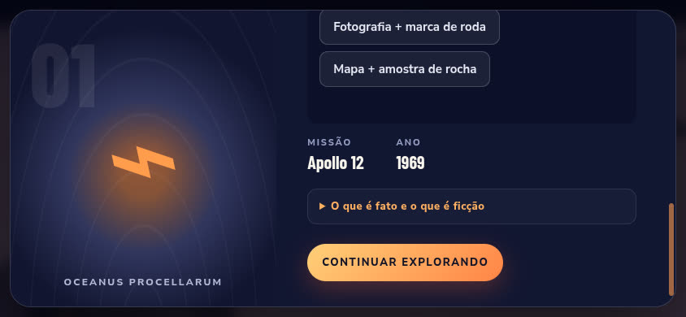
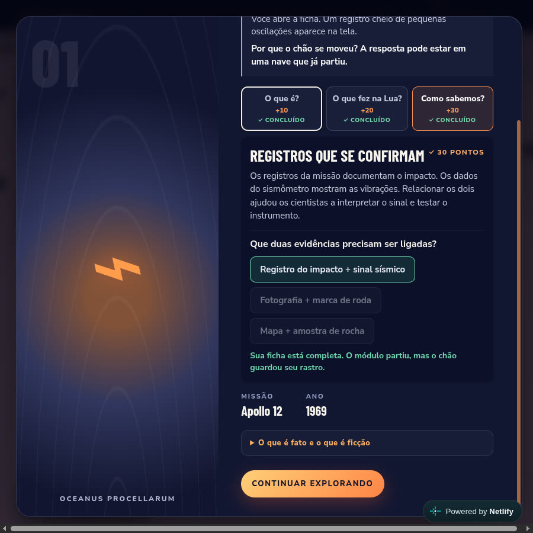
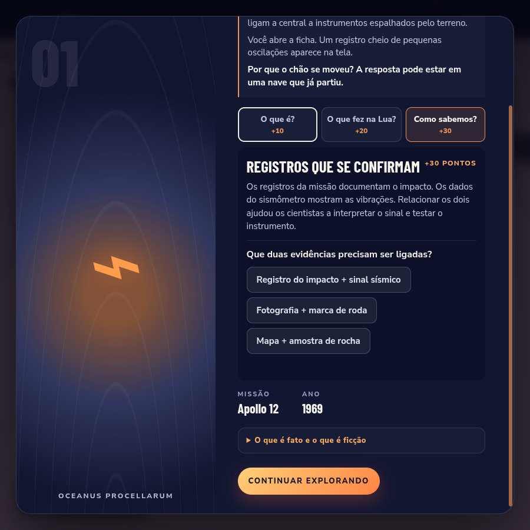

# Rolagem das modais

## Problema

Na ficha do equipamento, o conteúdo de baixo ficava cortado: dados da missão, "O que é fato e o que é ficção" e o botão **Continuar explorando**. Não aparecia barra de rolagem e não havia como chegar ao fim. Acontecia em quase todas as telas de computador, inclusive no 1366×768, a mais comum em notebooks.

A coluna de texto tinha `overflow-y: auto`, mas, dentro da grade do cartão, a linha crescia junto com o conteúdo. A coluna nunca ficava menor que o próprio texto, então não havia o que rolar, e o cartão (`overflow: hidden`, `max-height: 92vh`) simplesmente cortava o excesso.

No celular deitado, a tela de abertura também ficava cortada: o conteúdo centralizado passava da altura da tela sem rolagem.

| Antes (1366×768): termina em "MISSÃO · ANO", sem botão |
|---|
|  |

## Correção (`src/style.css`)

- **Ficha:** a linha da grade passou a ser `minmax(0, 1fr)` e a coluna de texto ganhou `min-height: 0` e altura máxima igual à do cartão. Agora o texto rola dentro da coluna, e a imagem do equipamento fica parada.
- **Altura máxima** da ficha e do epílogo: `100dvh` menos o espaçamento da modal. Isso acompanha a barra de endereço do celular, que aparece e some, e o espaçamento diminui em telas baixas (`clamp(10px, 3vh, 30px)`).
- **Modal e abertura:** centralizam com `margin: auto` em vez de `place-items: center`. Quando a tela é baixa, o topo não fica mais fora de alcance e a área ganha rolagem.
- **Celular em pé (até 780 px):** o cartão inteiro rola, com a imagem em cima e o texto embaixo, sem rolagem dentro de rolagem.
- **Barra de rolagem visível**, fina e laranja, para mostrar que há mais conteúdo.
- `overscroll-behavior: contain`: rolar a ficha até o fim não arrasta a página atrás.
- **Sem rolagem lateral:** com `overflow-y: auto`, o navegador também liga a rolagem horizontal da modal, e o cartão (`95vw`) mais o espaçamento passava da largura em telas de até ~1140 px. O cartão passou a usar `100%` do espaço da modal, e a modal ganhou `overflow-x: hidden`. Esse problema foi encontrado ao testar a primeira versão da correção no Netlify.

| Depois (1366×768) | Celular deitado (844×390) | Celular (390×844) |
|---|---|---|
|  |  |  |

| Rolagem lateral (900×900): antes, barra embaixo | Depois |
|---|---|
|  |  |

## Testes

Roteiro: [`testes/roteiro-rolagem.mjs`](testes/roteiro-rolagem.mjs) · resultado: [`testes/resultados-rolagem.json`](testes/resultados-rolagem.json)

Em cada tamanho de tela, o roteiro rola tudo o que é rolável e verifica se o último elemento fica visível (botão da abertura, botão "Continuar explorando" nas abas 1 e 3, botão do epílogo). Também confirma que a **roda do mouse** rola a ficha e que **nada rola para o lado**.

| Tela | Antes | Depois |
|---|---|---|
| 1366×768, 1280×720, 1366×600 | ❌ ficha cortada | ✅ |
| 1024×768, 900×900, 1024×600 | ❌ ficha cortada e rolagem lateral | ✅ |
| 844×390 (celular deitado) | ❌ ficha e abertura cortadas | ✅ |
| 768×1024, 390×844 | ✅ | ✅ |

O mesmo roteiro, adaptado para abrir a ficha pela rota de exploração, também rodou no site publicado no Netlify.

Regressão: 12 missões no computador **72/72** e no tablet **71/71**.
