# Validação da Missão 01 — ALSEP da Apollo 12

Data: 14/11/2026 · Branch: `fix/validacao-missao-01`

## Como foi testado

- Chrome 157 no Linux, com GPU Intel UHD 620 (cerca de 60 fps), dirigido por um roteiro automatizado ([testes/roteiro-missao-01.mjs](testes/roteiro-missao-01.mjs)).
- Computador: 1366×768. Tablet: 1024×768 (paisagem) e 768×1024 (retrato), com toque simulado.
- Também testados a versão de produção (`npm run build` + `vite preview`) e um navegador sem WebGL.
- **Não testados:** Microsoft Edge e tablets físicos. A equipe precisa conferir os dois.

**Resultado: 43 de 43 verificações aprovadas** ([testes/resultados.json](testes/resultados.json)).

## Problemas encontrados no protótipo

| # | Problema | Status |
|---|---|---|
| F1 | Depois de fechar, a ficha não podia mais ser reaberta | ✅ corrigido |
| F2 | Completar 60/60 não mudava objetivo, rota nem progresso | ✅ corrigido |
| F3 | Clicar numa opção errada depois do acerto apagava a mensagem de sucesso; reabrir a aba perdia o acerto | ✅ corrigido |
| F4 | Clicar no equipamento não abria a ficha (o roteiro pede "ao clicar no equipamento") | ✅ corrigido |
| F5 | A dica de erro era sempre a mesma | ✅ pista própria em cada atividade |
| M1 | Velocidade dependia dos fps (lenta em PCs fracos) | ✅ corrigido |
| M2 | W/A/S/D não seguiam a câmera depois de girá-la | ✅ corrigido |
| M3 | Teclas "presas" quando a janela perdia o foco | ✅ corrigido |
| M4 | O astronauta atravessava os objetos | ✅ colisão simples |
| M5 | A câmera não acompanhava o astronauta (só girava parada) | ✅ corrigido |
| M6 | As setas giravam a câmera e moviam o astronauta ao mesmo tempo | ✅ corrigido |
| T1 | Impossível jogar no tablet | ✅ joystick na tela |
| T2 | Sem WebGL, tela quebrada sem explicação | ✅ mensagem orientando |
| C1 | O modelo exibido (módulo lunar) não era o ALSEP | ✅ ALSEP como objeto; módulo da NASA ao lado, como marco do pouso |
| C2 | Aviso dizia "Estação Lunar" e a ficha dizia "ALSEP" | ✅ nome vem de `story-data.ts` |
| C3 | Textos de 7 a 13 px, pequenos para crianças | ✅ 10 a 17 px; opções com área de toque de 44 px |

## Verificações pedidas

| Item | Resultado |
|---|---|
| Carregamento dos modelos 3D | ✅ cerca de 3 s, todos carregados |
| Movimentação e direção | ✅ 4,5 unidades/s; W segue a câmera mesmo girada |
| Câmera | ✅ acompanha o astronauta; setas não a giram |
| Colisões e limites | ✅ não atravessa a estação, os instrumentos, o módulo e as rochas; limite de ±25 |
| Detecção do objeto | ✅ aviso a 7,5 unidades; reaparece ao voltar |
| Abrir e fechar a ficha | ✅ botão, tecla E, clique no equipamento; Esc, clique fora, botão |
| Textos | ✅ conferem com o documento de histórias |
| Respostas certas e erradas | ✅ erro mostra pista e não dá pontos |
| Pontuação 10 + 20 + 30 | ✅ 60 |
| Pontos duplicados | ✅ impossível |
| Continuidade após fechar | ✅ progresso salvo (inclusive ao recarregar a página) |
| Erros no console | ✅ nenhum |
| Chrome | ✅ · Edge: ⚠️ não testado |

## Avaliação: a estrutura serve para os 12 objetos?

Sim. As 12 histórias do documento seguem o mesmo formato (encontro, três camadas de 10/20/30 pontos, frase de sucesso), que cabe no tipo `StoryStep`. Para replicar, os dados passam de `firstDiscovery` para uma lista de descobertas, cada uma com posição no mapa e modelo 3D.

## Capturas

### Antes

| Cena inicial | A câmera não acompanha |
|---|---|
| 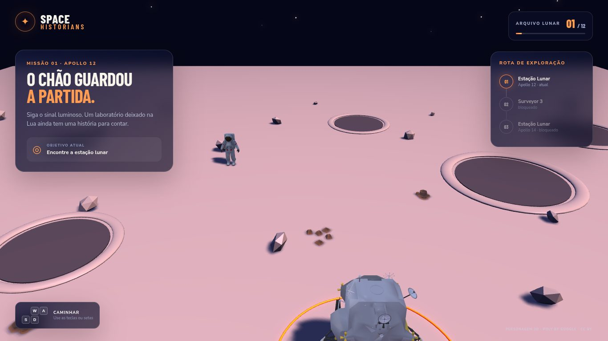 | 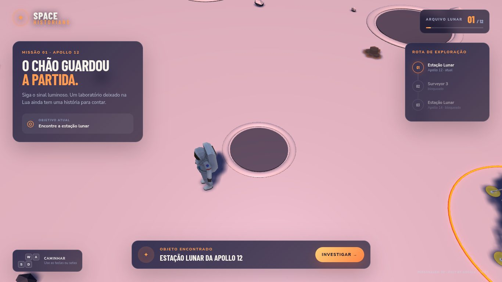 |

| Após fechar: sem como reabrir | Tablet: sem controles |
|---|---|
| 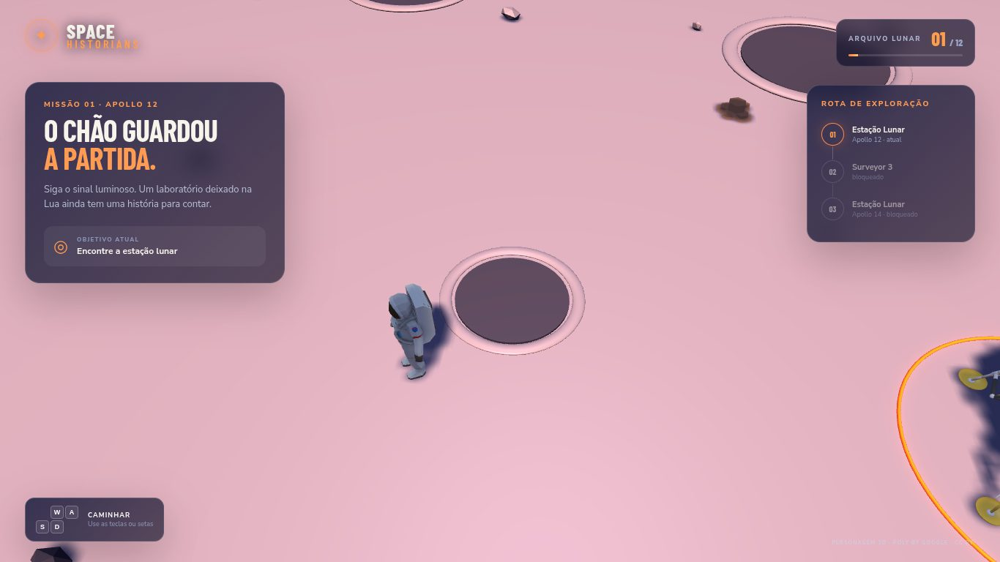 | 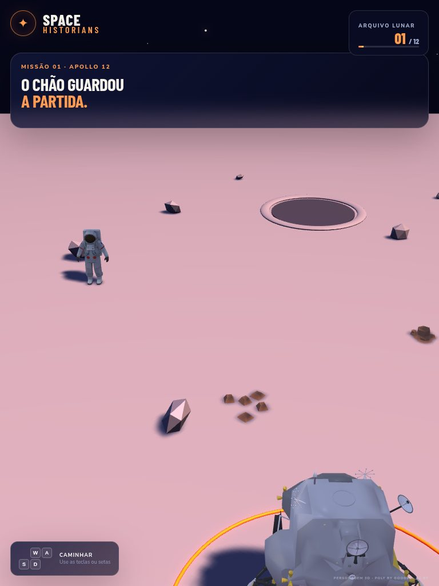 |

### Depois

| Aviso perto do ALSEP | Quiz: acerto travado e pista |
|---|---|
| 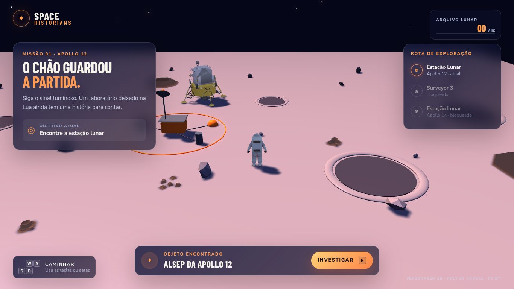 | 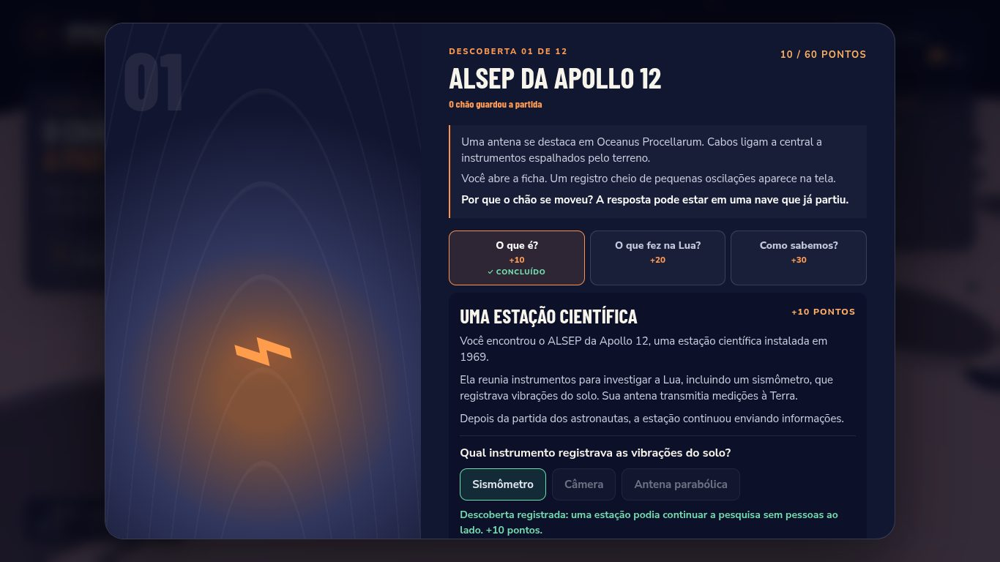 |

| Ficha concluída | Concluído: rota, objetivo, reabrir |
|---|---|
| 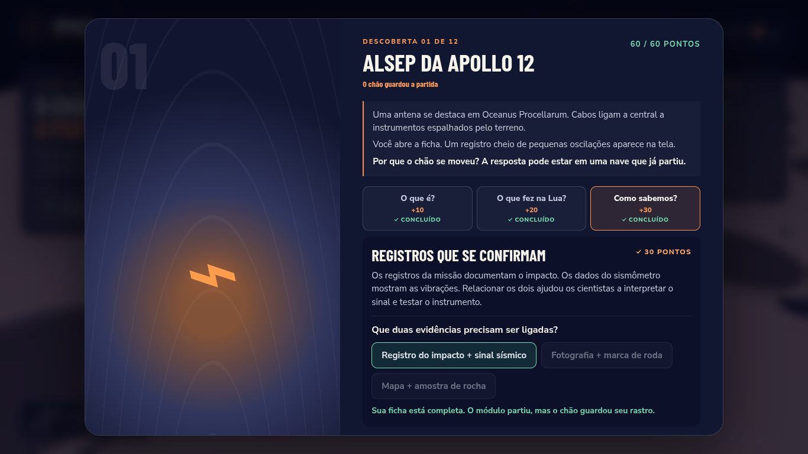 | 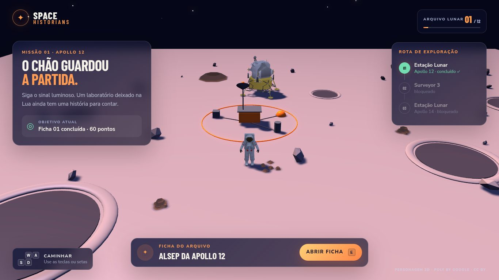 |

| Tablet: joystick | Tablet: ficha |
|---|---|
| 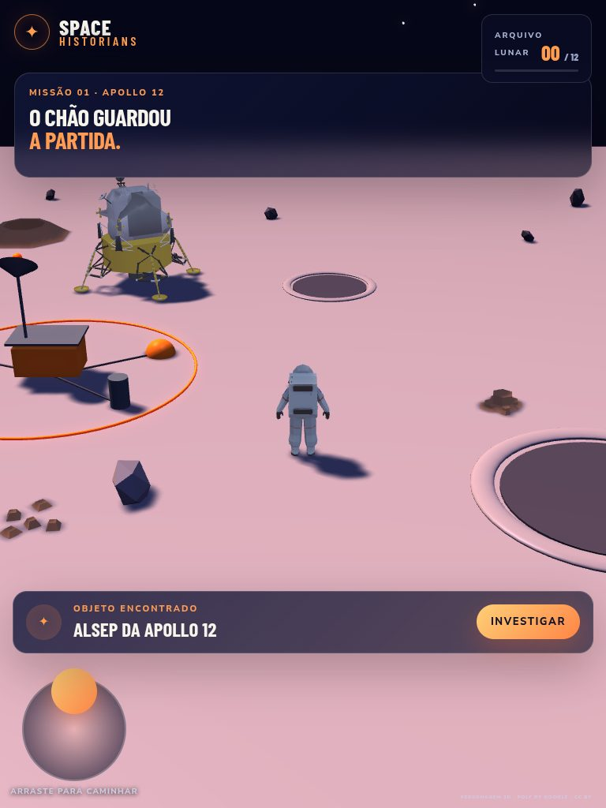 | 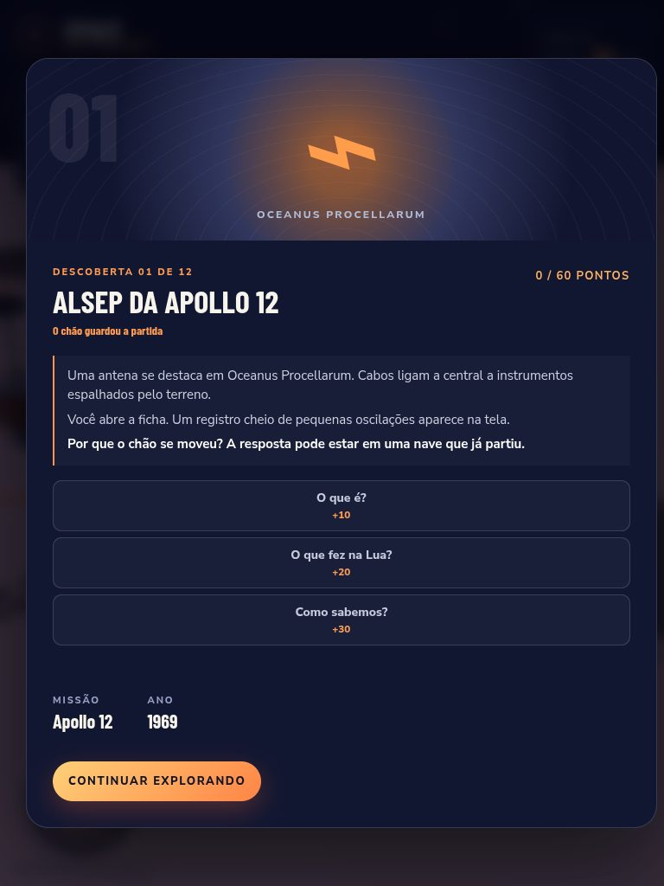 |

| Câmera girada | Sem WebGL |
|---|---|
| 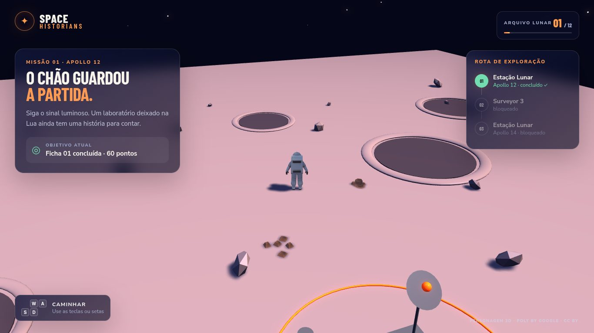 | 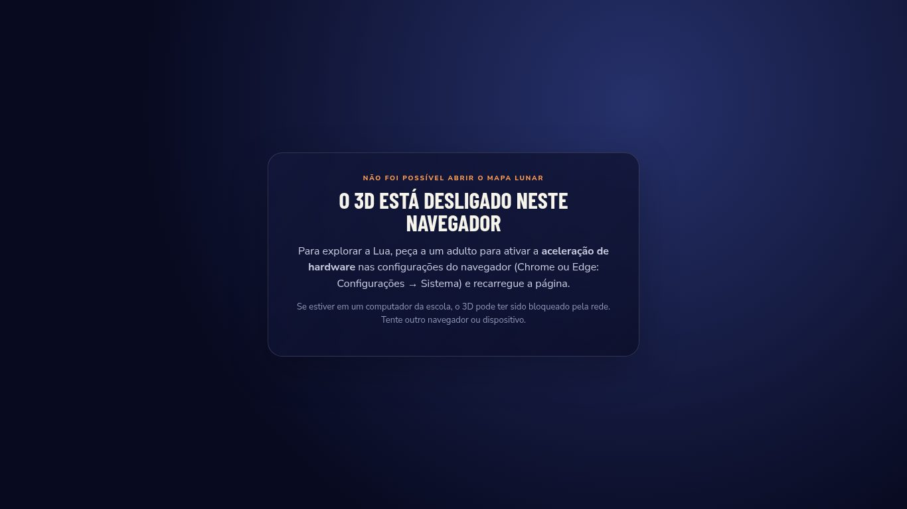 |

## Como rodar o roteiro de testes

Requer o Google Chrome instalado e o servidor de desenvolvimento rodando (`npm run dev`):

```bash
npm i -D playwright-core
node docs/validacao-missao-01/testes/roteiro-missao-01.mjs http://127.0.0.1:5173/ ./capturas
```
